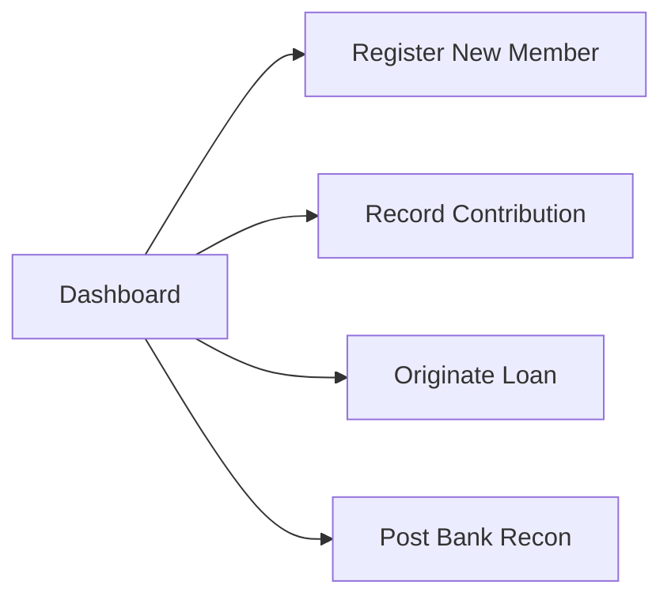

# 🧭 Wiki: Executive Dashboard (`/dashboard`)

The **Executive Dashboard** serves as the central command center for the cooperative leadership, board of directors, management committee, and financial auditors. It provides real-time visibility into cooperative solvency, member engagement, credit portfolio health, and financial liquidity.

---

## 1. Overview & Business Objectives

- **Primary Goal**: Deliver a single-pane-of-glass overview of the cooperative's operating performance for the active fiscal year.
- **Key Metrics Tracked**: Active member participation, gross loan portfolio size, total interest earned, cumulative member repayments, and active capital distribution.
- **Role Permissions**: Accessible by all authenticated cooperative personnel (**Administrator** and **Loan Officer / User**).

---

## 2. Key Performance Indicators (KPI Cards)

At the top of the dashboard, four synchronized KPI summary cards provide real-time metrics computed directly from PostgreSQL ledger data:

| Metric Card | Description | Underlying Formula / Source |
|---|---|---|
| **Active Members** | Count of registered cooperative members in good standing. | Count of members where `Status == 'ACTIVE'` divided by total registered members. |
| **Total Loan Portfolio** | Cumulative principal amount of all approved, active, and released loans. | $\sum \text{PrincipalAmount}$ across all issued loans. |
| **Interest Earned** | Total interest generated by cooperative lending operations. | $\sum \text{InterestEarned}$ across all active and completed loans (feeds the annual surplus pool). |
| **Collected Repayments** | Total cash principal remitted back into the cooperative treasury. | $\sum \text{PrincipalPaid}$ from all recorded amortization installments. |

---

## 3. Visual Charts & Analytics

### A. Member Capital Build-up vs. Loan Releases
- **Chart Type**: Comparative multi-metric bar & area visualization.
- **Purpose**: Tracks monthly capital accumulation against lending volume to ensure that the cooperative maintains adequate liquidity reserves and does not over-leverage its depository assets.
- **Healthy Threshold Indicator**: Capital contributions should consistently outpace or match net disbursements, maintaining a minimum 20% depository cash cushion.

### B. Loan Portfolio Status Breakdown
- **Chart Type**: Segmented donut / progress distribution.
- **Categories**:
  - `ACTIVE`: Loans currently being amortized on schedule.
  - `APPROVED`: Loans cleared by credit committee awaiting fund disbursement.
  - `PAID`: Completed loans where 100% of scheduled installments are paid in full.
  - `REJECTED`: Applications failing creditworthiness or collateral guidelines.

---

## 4. Quick Action Hub

The dashboard provides immediate access to high-frequency operational tasks:

1. **Register New Member** (`/members`): Launches member onboarding drawer.
2. **Record Cutoff Contribution** (`/contributions`): Opens the semi-monthly capital deposit dialog with automatic uncontributed-cutoff filtering.
3. **Originate New Loan** (`/loans`): Opens the multi-step loan origination wizard with instant amortization generation.
4. **Post Bank Statement Reconciliation** (`/accounting`): Enters official monthly depository bank balances *(Admin only)*.

---

## 5. Member Self-Service Portal Dashboard

When an authenticated user with the **Member** role logs in, they are presented with their dedicated self-service overview:

1. **Member Header & Identifiers**:
   - Displays full name, Member Code (e.g., `MEM-2026-003`), and membership badge.
2. **Personal Equity & Credit KPIs**:
   - **My Share Capital**: Real-time cumulative contributions remitted to date with total cutoffs count.
   - **Active Loan Balance**: Current outstanding loan balance across all active amortizations.
   - **Next Cutoff Repayment**: Amount due on the upcoming semi-monthly payroll cutoff.
3. **FIFO Loan Queue Integration**:
   - **"Need Financial Assistance? Apply for a Loan" Panel**: Dedicated action banner with a **"Request Loan"** button launching the 7-tier preview modal (₱1,000–₱80,000).
   - **Live Loan Queue Tracker Card**:
     - Activates automatically upon submitting a loan request.
     - Displays the member's current **Queue Position** (e.g., `Position #1 · Next in line for bank fund release` or `X ahead in line`).
     - Shows the **Estimated Funding Cutoff** date and real-time status badge (`In Line for Funding`, `Board Reviewing`, `Ready for Funding`).
     - Automatically clears from the dashboard once disbursed, with the new credit account appearing directly in their loan portfolio.

---

## 6. Daily Operating Checklist for Cooperative Managers

1. **Morning Review**:
   - Check the **Active Members** count for pending KYC onboarding.
   - Inspect **Total Loan Portfolio** vs. **Collected Repayments** to assess current lending velocity.
2. **Liquidity Check**:
   - Confirm that collected repayments and new share capital contributions are sufficient to fund pending loan releases.
3. **Cross-Navigation**:
   - Click the metric card links or header shortcuts to drill down directly into specific ledgers.

---

## 7. Frequently Asked Questions (FAQ)

**Q: Why does the Interest Earned card differ from Depository Bank Cash?**  
*A*: Upfront loan interest is recognized upon loan origination and credited to the cooperative's distributable surplus pool. Cash in bank reflects actual physical depository balances, which change as loans are disbursed and repayments are collected.

**Q: How often is the dashboard refreshed?**  
*A*: The dashboard uses React Query with real-time caching. Navigating to the page or clicking **Refresh Books** in child modules triggers an instant re-query against the PostgreSQL database.

