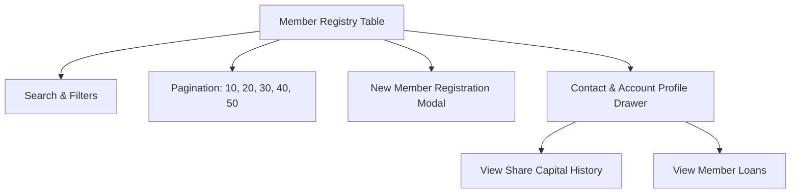

# 👥 Wiki: Member Assembly & Registry (`/members`)

The **Member Registry** is the central ledger of all cooperative stakeholders. It maintains member identities, membership codes, contact information, account statuses, and serves as the master anchor for contributions and loan underwriting.

---

## 1. Overview & Business Objectives

- **Primary Goal**: Maintain an accurate, auditable registry of all cooperative members in compliance with cooperative statutory guidelines.
- **Key Capabilities**: Onboarding new members, viewing member profile records, inspecting historical participation, and managing membership standing.
- **Role Permissions**:
  - **Administrator**: Full read/write access (create members, update contact details, deactivate/reactivate accounts).
  - **Loan Officer (User)**: Read-only access to member directories for credit evaluation and identity verification.

---

## 2. Member Attributes & Data Dictionary

| Field Name | Type | Validation / Description |
|---|---|---|
| **Member Code** | String (Unique) | Formatted as `MEM-YYYY-XXX` (e.g. `MEM-2026-001`) or custom officer prefixes. Immutable identifier. |
| **First & Last Name** | String | Official legal name matching government-issued identification. |
| **Email Address** | String (Unique) | Contact email for electronic statements and official communications. |
| **Phone Number** | String | Primary mobile or telephone contact. |
| **Date Joined** | Date | Official date the member's application was approved by the Board. |
| **Status** | Enum | `ACTIVE` (Good standing; eligible for loans and dividends) or `INACTIVE` (Dormant or resigned). |

---

## 3. UI Features & Navigation

### A. Search & Filter Bar
- **Instant Search**: Filters across Member Code, First Name, Last Name, and Email address simultaneously.
- **Status Filter**: Toggle between `All Members`, `Active Only`, and `Inactive Only`.

### B. Standardized Table Pagination
- Default view is **20 members per page**.
- Configurable via the bottom selector: **10, 20, 30, 40, or 50** rows per page.
- Direct page jump buttons (`Previous`, `Next`, numbered pills).

### C. Member Profile Drawer (`MemberDetailsDrawer`)
Clicking any member's row or **View Profile** button opens a sliding drawer containing:
1. **Header Badge**: Member Code, status badge, and join date.
2. **Contact Card**: Email address, mobile telephone, and address.
3. **Financial Snapshot**:
   - Total Accumulated Share Capital.
   - Active Loans Count and Outstanding Balances.
4. **Direct Navigation Shortcuts**:
   - Link to **Share Capital Statement & 24-Cutoff Grid** (`/contributions`).
   - Link to **Borrower Credit Ledger** (`/loans`).

---

## 4. Step-by-Step Operator Procedures

### A. Registering a New Member
1. Navigate to `/members` from the sidebar.
2. Click the green **+ Register Member** button in the top right.
3. Fill in the required fields:
   - **First Name** and **Last Name** (Legal name).
   - **Email Address** (Must be unique across the database).
   - **Phone Number**.
   - **Date Joined** (Defaults to current date).
4. Click **Create Member Account**.
5. The system generates a distinct `MemberCode` and assigns `Status = ACTIVE`.

### B. Updating Member Status or Contact Details *(Admin Only)*
1. Locate the member using the search bar or table pagination.
2. Click the **View Profile** button on the right side of the row.
3. Review contact information and update if necessary.
4. If a member resigns or becomes dormant, toggle status to `INACTIVE`.
   > [!NOTE]
   > Inactive members cannot be selected for new loan originations or new cutoff contributions until reactivated.

---

## 5. Business Rules & Safeguards

- **Email & Member Code Uniqueness**: Enforced via PostgreSQL unique indexes. Duplicate emails or codes are rejected with a descriptive error.
- **Loan Pre-requisite**: A member must have an `ACTIVE` status to qualify for loan origination.
- **Capital Accumulation**: All member share capital contributions are strictly tied to their `MemberId` foreign key and preserved across all fiscal years.

