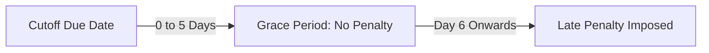

# 💰 Wiki: Capital Contributions & Build-up (`/contributions`)

The **Capital Contributions** module manages the core equity foundation of the cooperative. Member share capital build-up represents member ownership stakes, drives borrowing capacity, and forms the mathematical basis for statutory dividend allocations.

---

## 1. Overview & Business Objectives

- **Primary Goal**: Track and reconcile periodic share capital contributions across the 24 semi-monthly calendar cutoffs of the fiscal year.
- **Key Capabilities**: Recording capital remittances, visual monitoring of member contribution compliance, grace period enforcement, and automatic late penalty calculations.
- **Role Permissions**:
  - **Administrator**: Full access (record contributions, edit remittance records, inspect member statements).
  - **Loan Officer (User)**: Read-only access to verify member capital build-up prior to loan approval.

---

## 2. The 24 Semi-Monthly Cutoff Calendar

CoopIS organizes capital build-up around 24 standardized semi-monthly fiscal cutoffs per year:
- **Mid-Month Cutoff**: Due on the **15th** of each month (`Jan-15`, `Feb-15`, ..., `Dec-15`).
- **End-of-Month Cutoff**: Due on the **last day** of each month (`Jan-31`, `Feb-28/29`, ..., `Dec-31`).

```
[ Cutoff 1: Jan-15 ]  -->  [ Cutoff 2: Jan-31 ]  -->  ...  -->  [ Cutoff 24: Dec-31 ]
```

---

## 3. Contribution Grace Period & Late Penalty Rules

To accommodate payroll processing delays while maintaining fiscal discipline, CoopIS enforces a statutory grace policy:



1. **5-Day Grace Period**:
   - Members have **5 calendar days** following the cutoff due date (`cutoffDate + 5 days`) to remit contributions without penalty.
2. **Late Penalty Charge Rate**:
   - Contributions submitted after the 5-day grace window incur the **Late Penalty Charge Rate** (configured in **Financial Policy**, e.g., 5%).
   - The penalty is calculated as:
     $$\text{Late Penalty} = \text{Contribution Amount} \times \text{Late Penalty Rate}$$
   - Collected penalties are channeled into the cooperative's gross surplus pool and distributed during year-end profit sharing.

---

## 4. Visual 24-Cutoff Period Grid (`MemberDetailsDrawer`)

When viewing any member's Share Capital Statement, the system renders a visual interactive 24-box matrix (`C01` through `C24`):

| Color Indicator | Status | Criteria |
|---|---|---|
| 🟢 **Emerald** | **Contributed on Time** | Remitted on or before the cutoff date. |
| 🟡 **Amber** | **Grace Window / Late Remittance** | Remitted within the 5-day grace window or post-grace with penalty settled. |
| 🔴 **Rose** | **Overdue / Missed** | Past due date (+5 grace days) with no recorded remittance. |
| ⚪ **Slate** | **Upcoming** | Future cutoff period not yet due. |

Clicking any cutoff pill displays the transaction timestamp, payment channel, OR/reference number, and penalty status.

---

## 5. Step-by-Step Operator Procedures

### A. Recording a Single Member Contribution
1. Navigate to `/contributions`.
2. Click the green **+ Record Contribution** button.
3. Select the **Member** from the searchable dropdown.
4. **Select Cutoff Period**:
   > [!IMPORTANT]
   > The **Assign to Cutoff Period** dropdown dynamically queries the database and displays **only the cutoffs that this member has NOT yet contributed to**. This prevents duplicate contributions.
   - If the member missed an earlier closed cutoff, that past cutoff appears in the list so a retroactive remittance can be posted.
5. Enter the **Contribution Amount (₱)** (defaults to the member's standard share capital amount, e.g., ₱1,000.00).
6. Select the **Payment Channel**:
   - `Payroll Deduction`: Standard corporate/institutional remittance.
   - `Cash Deposit`: Over-the-counter teller payment.
   - `Bank Transfer`: Direct bank deposit (requires reference number).
7. Enter the **Official Receipt (OR) / Reference Number**.
8. Click **Save Contribution**.

### B. Reviewing Member Contribution Compliance
1. In the Contributions table, locate the member.
2. Click the **View Statement** button on the right.
3. The drawer opens showing:
   - Total Share Capital Balance.
   - 24-Cutoff Visual Indicator Grid.
   - Filter tabs: `All Cutoffs`, `Contributed (Paid)`, and `Delayed / Overdue`.
   - Complete itemized chronological remittance ledger.

---

## 6. Business Rules & Safeguards

- **Strict Non-Duplication**: A member can have at most **one** contribution record per cutoff period. The backend database enforces a unique composite constraint `(MemberId, CutoffId)`.
- **Closed Cutoff Support**: Administrators can record late remittances for already-closed cutoffs if a member fell behind on payroll deduction, but cannot duplicate an existing remittance.
- **Immediate General Ledger Sync**: Every contribution posted immediately increases **Common Share Capital** and **Cash in Bank** on the General Ledger (`/accounting`).
