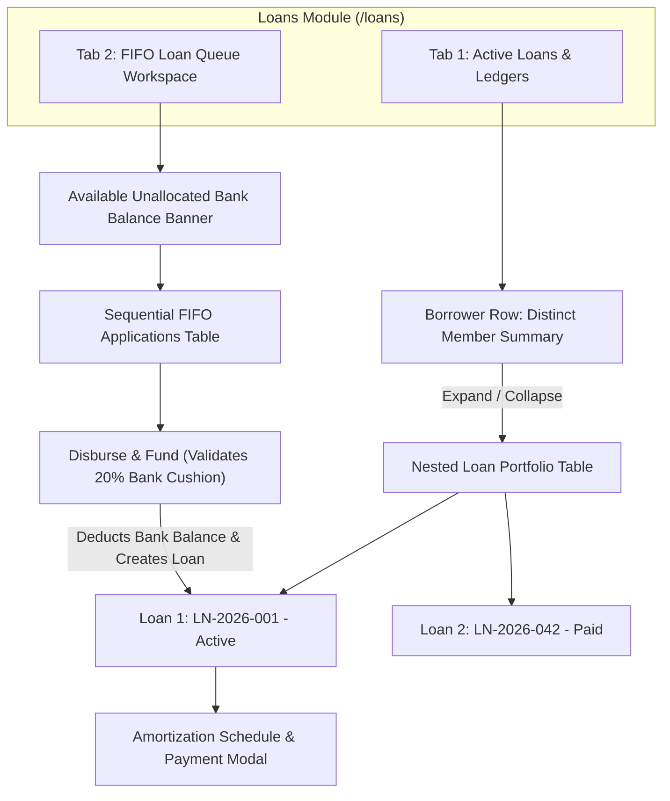

# 💼 Wiki: Credit Management & Loan Portfolios (`/loans`)

The **Credit Management & Loans** module handles member credit origination, interest computation, net disbursement, amortization scheduling, installment collection, and late penalty enforcement.

---

## 1. Overview & Business Objectives

- **Primary Goal**: Provide a rigorous, transparent credit lifecycle system that maximizes capital velocity, prevents portfolio delinquency, and automates repayment collection.
- **Key Capabilities**: Multi-step loan origination, dynamic amortization schedule generation, distinct borrower aggregation, installment payment recording, and automated delinquency penalty tracking.
- **Role Permissions**: Accessible by both **Administrator** and **Loan Officer (User)**.

---

## 2. Core Financial Concepts & Formulas

### A. Upfront Interest & Net Proceeds
Loans in CoopIS employ an upfront flat interest deduction model:
$$\text{Upfront Interest Earned} = \text{Principal Amount} \times \left(\frac{\text{Interest Rate \%}}{100}\right)$$
$$\text{Net Proceeds Released} = \text{Principal Amount} - \text{Upfront Interest Earned}$$

*Example*:
- Principal: ₱10,000.00
- Interest Rate: 5% flat
- Upfront Interest: ₱500.00
- Net Released to Member: **₱9,500.00**
- Total to be Repaid via Amortization: **₱10,000.00**

### B. Semi-Monthly Installment Amortization
The principal is divided equally across the scheduled semi-monthly cutoffs:
$$\text{Base Cutoff Payment} = \text{Round}\left(\frac{\text{Principal Amount}}{\text{Total Cutoffs}}, 2\right)$$
- **Cent-Balancing Guard**: Any rounding discrepancies in the final cent are adjusted on the **final installment** so that the sum of all installments matches the exact principal amount to the cent:
  $$\text{Final Installment Amount} = \text{Principal Amount} - \sum_{i=1}^{N-1} \text{Scheduled Installment}_i$$

### C. 14-Day Loan Grace Period & Late Penalties
- **Loan Grace Window**: Borrowers are granted **14 calendar days** beyond the cutoff due date (`cutoffDate + 14 days`) to settle their installment.
- **Late Penalty Imposition**: On day 15 post-cutoff, if the installment balance remains unpaid, a late penalty is assessed on the remaining unpaid principal balance:
  $$\text{Late Penalty} = \text{Unpaid Installment Balance} \times \text{Late Penalty Rate \%}$$
- **Prospective Policy Lock**: The interest rate, grace period, and late penalty charge rate are locked at the time of loan creation and never change retroactively.

### D. The 7-Tier Cooperative Loan Matrix
To standardize credit underwriting and match loan terms to borrower capacity, credit facilities follow a progressive 7-tier schedule:

| Tier | Principal Range (₱) | Term (Months) | Cutoffs Count | Bi-Monthly Amortization Formula | Upfront Int. (5%) |
|:---:|:---:|:---:|:---:|:---:|:---:|
| **Tier 1** | ₱1,000 – ₱5,000 | 2 Months | 4 Cutoffs | $\text{Principal} / 4$ | ₱50 – ₱250 |
| **Tier 2** | ₱5,001 – ₱15,000 | 3 Months | 6 Cutoffs | $\text{Principal} / 6$ | ₱250.05 – ₱750 |
| **Tier 3** | ₱15,001 – ₱25,000 | 4 Months | 8 Cutoffs | $\text{Principal} / 8$ | ₱750.05 – ₱1,250 |
| **Tier 4** | ₱25,001 – ₱35,000 | 5 Months | 10 Cutoffs | $\text{Principal} / 10$ | ₱1,250.05 – ₱1,750 |
| **Tier 5** | ₱35,001 – ₱50,000 | 6 Months | 12 Cutoffs | $\text{Principal} / 12$ | ₱1,750.05 – ₱2,500 |
| **Tier 6** | ₱50,001 – ₱70,000 | 7 Months | 14 Cutoffs | $\text{Principal} / 14$ | ₱2,500.05 – ₱3,500 |
| **Tier 7** | ₱70,001 – ₱80,000 | 8 Months | 16 Cutoffs | $\text{Principal} / 16$ | ₱3,500.05 – ₱4,000 |

*Maximum Loan Cap*: ₱80,000.00 per member borrower.

---

## 3. UI Architecture: Expandable Portfolios & FIFO Queue Workspace

The `/loans` interface integrates two specialized workspaces:
1. **Active Loans & Ledgers**: Expandable borrower portfolio view.
2. **FIFO Loan Queue Workspace** (`/loans/queue` or tab switch): Real-time liquidity management and sequential disbursement engine.



### Level 1: Distinct Borrower Row
Displays aggregated totals across all loans for each borrower:
- **Borrower Info**: Member Code, Full Name, Contact info.
- **Loan Accounts Badge**: e.g., `1 Active / 2 Paid`.
- **Active Principal**: Total principal across active credit accounts.
- **Repayment Progress**: Visual progress bar indicating percentage repaid.
- **Total Active Balance**: Outstanding principal remaining.
- **Semi-Monthly Due**: Combined repayment due on the current fiscal cutoff.
- **Total Late Penalties**: Cumulative penalties (`Paid + Accrued`).

### Level 2: Nested Loan Portfolio Sub-Rows
Clicking the chevron (▶) expands all loans belonging to that member:
- **Reference**: e.g., `LN-2026-057`.
- **Principal Amount**: Face value of the loan.
- **Upfront Interest**: Retained interest fee.
- **Net Release**: Cash disbursed.
- **Amortization**: Installment progress (e.g., `4 of 6 cutoffs paid`).
- **Remaining Balance**: Current balance to zero.
- **Late Penalties**: Itemized penalties for this loan.
- **Status Badge**: `ACTIVE`, `APPROVED`, `PAID`, or `PENDING_APPROVAL`.
- **Actions**: **Payment History** button.

---

## 4. Step-by-Step Operator Procedures

### A. Originating a New Loan
1. Navigate to `/loans`.
2. Click the green **+ Originate Loan** button to launch the multi-step wizard.
3. **Step 1: Borrower Selection**:
   - Choose an active member from the searchable dropdown.
   - The wizard displays the member's current share capital and outstanding loan balance.
4. **Step 2: Loan Terms**:
   - Enter **Principal Amount (₱)** (e.g., ₱20,000.00).
   - Select **Term**: 3 Months (6 cutoffs), 6 Months (12 cutoffs), 12 Months (24 cutoffs), etc.
   - Review the auto-computed **Upfront Interest (₱)** and **Net Release (₱)**.
   - Enter **Origination / Release Date**.
5. **Step 3: Preview Schedule**:
   - Inspect the generated 2-decimal amortization schedule.
6. Click **Approve & Disburse Loan**.

### B. Recording an Amortization Payment
1. Locate the borrower and expand their row.
2. Click **Payment History** on the target loan to open `AmortizationScheduleModal`.
3. Locate the due cutoff installment in the schedule table.
4. Click the red or amber **Record Payment** button on the installment row.
5. In the **Record Cutoff Repayment** dialog:
   - System auto-fills the **Principal Repayment Amount (₱)**.
   - If the payment is delayed past the 14-day grace window, the system highlights **Delayed Payment Detected** and pre-calculates the **Late Penalty Charge (₱)**.
   - Select the **Payment Channel**: `Cash Deposit`, `Payroll Deduction`, or `Bank Transfer`.
   - Optional: Enter official receipt or payroll notes.
6. Click **Submit Repayment**.
7. The installment status changes immediately to **PAID** with a green badge.

### C. FIFO Loan Queue Application & Funding Workflow
To address beginning-of-year and cyclical liquidity shortages, loan disbursements are prioritized via an automated **First-In, First-Out (FIFO) Priority Queue**:

```mermaid
sequenceDiagram
    autonumber
    actor Member
    participant Queue as FIFO Queue Service
    participant Bank as Primary Bank Account
    actor Admin
    participant Ledger as Active Loan Portfolio

    Member->>Queue: Submit Loan Request (₱1,000 - ₱80,000)
    Queue-->>Member: Assigns Sequential Queue # & Shows Tracker Card
    Admin->>Queue: Inspect FIFO Loan Queue Workspace
    Note over Admin,Bank: System validates Available Liquid Cash >= Desired Principal (after 20% cushion)
    Admin->>Queue: Click "Disburse & Fund"
    Queue->>Bank: Deducts Requested Principal from Primary Bank Account
    Queue->>Ledger: Creates formal Loan (5% upfront interest deducted + schedule)
    Queue-->>Admin: Transitions Queue status to "Disbursed"
    Note over Queue: Clears from "Active Queue" filter into "Disbursed" archive
    Queue-->>Member: Live Tracker clears; Active Loan appears under My Loans
```

1. **Member Submission**:
   - Member opens their dashboard and clicks **"Request Loan"** in the **Need Financial Assistance?** panel.
   - Selects desired principal amount (e.g. ₱20,000.00) with instant 7-tier preview (4 months, 8 cutoffs, ₱1,000 5% upfront deduction, ₱19,000 net proceeds, ₱2,500 semi-monthly cutoff payment).
   - Enters loan purpose and submits.
   - The system validates against the 7-tier matrix, generates the next sequential `QueueNumber` (FIFO order), and sets status to `Queued`.
   - The member's dashboard displays a real-time **Loan Queue Tracker** card showing their exact position in line (e.g., `Position #1 · Next in line for bank fund release` or `X ahead in line`).
2. **Administrative Review**:
   - Administrator navigates to `/loans` $\rightarrow$ **FIFO Loan Queue Workspace** (or `/loans/queue`).
   - The top banner displays **Available Unallocated Bank Balance for Lending** (current primary bank balance minus a strict 20% liquid reserve cushion).
   - Applications are listed strictly ordered by `QueueNumber` ascending.
   - Status transitions can be stepped through: `Queued` $\rightarrow$ `UnderReview` $\rightarrow$ `ReadyForFunding`.
3. **Disbursement & Funding**:
   - Administrator clicks **Disburse & Fund**.
   - **Liquidity Safeguard Check**: The system validates that `Available Unallocated Bank Cash >= DesiredPrincipal`. If insufficient, the button is disabled with an explanatory tooltip.
   - Upon confirmation, an atomic database transaction:
     - Deducts the principal from the cooperative's primary `BankAccount`.
     - Generates a formal `Loan` record with `LN-YYYY-XXX` reference, 5% upfront interest deduction, and bi-monthly amortization schedule.
     - Transitions the queue entry to `Disbursed`.
   - **Operational Queue Clearing**:
     - In the **Admin Workspace**, the table defaults to **"Active Queue"** (`Queued`, `UnderReview`, `ReadyForFunding`). As soon as an application is disbursed, it automatically clears from the active table into the **"Disbursed"** and **"All History"** tabs.
     - In the **Member Portal**, the queue tracker card automatically clears, and the member's new loan appears under **My Loans & Amortization**.

---

## 5. Critical Safeguards & Automations

- **Duplicate Payment Prevention**: Once an installment is marked `PAID`, its **Record Payment** button is permanently removed and the backend rejects duplicate submissions for the same cutoff.
- **Automated Schedule-Driven `PAID` Status**:
  - The manual "Mark Paid" button has been intentionally removed to prevent administrative error.
  - A loan transitions to `PAID` **if and only if all scheduled cutoff installments are paid in full**.
  - If any installment remains unpaid, the loan remains strictly `ACTIVE`.
- **20% Statutory Bank Reserve Cushion**: The cooperative strictly safeguards a configurable **20% reserve cushion** on its primary bank accounts. Loan queue disbursements are physically blocked by the API and UI if an issuance would cause depository cash reserves to fall below this safety buffer.
- **Strict FIFO Disbursal Integrity**: Applications are assigned monotonically incrementing sequential queue numbers. Unfunded applications cannot be skipped or reordered arbitrarily, protecting member trust during tight liquidity periods.
- **Immutable Audit Trail Retention**: Records in the FIFO Loan Priority Queue are **never deleted**. Disbursed applications are archived with direct references to their issued loan IDs (`DisbursedLoanId`), disbursement timestamps, and approving administrative records.
- **Real-Time Accounting Sync**: Recording repayments automatically adjusts **Accounts Receivable** and increases **Cash in Bank** on the General Ledger.

