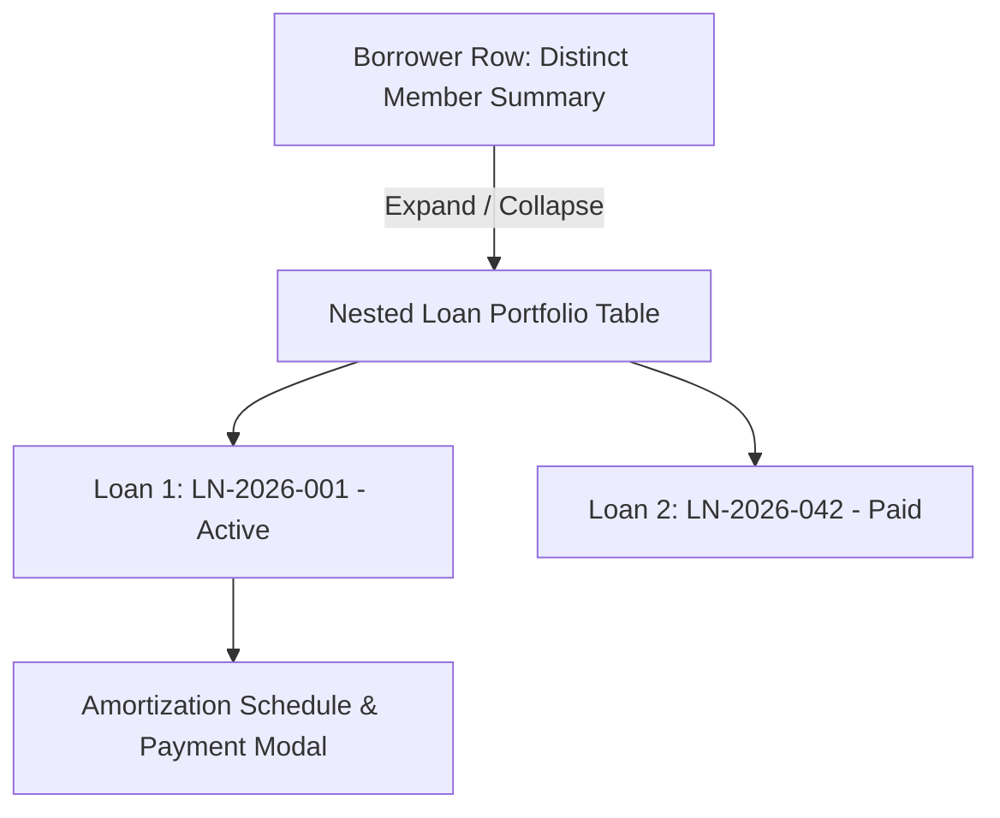

# 💼 Wiki: Credit Management & Loan Portfolios (`/loans`)

The **Credit Management & Loans** module handles member credit origination, interest computation, net disbursement, amortization scheduling, installment collection, and late penalty enforcement.

---

## 1. Overview & Business Objectives

- **Primary Goal**: Provide a rigorous, transparent credit lifecycle system that maximizes capital velocity, prevents portfolio delinquency, and automates repayment collection.
- **Key Capabilities**: Multi-step loan origination, dynamic amortization schedule generation, distinct borrower aggregation, installment payment recording, and automated delinquency penalty tracking.
- **Role Permissions**: Accessible by both **Administrator** and **Loan Officer (User)**.

---

## 2. Core Financial Concepts & Formulas

### A. Upfront Interest & Net Proceeds
Loans in CoopIS employ an upfront flat interest deduction model:
$$\text{Upfront Interest Earned} = \text{Principal Amount} \times \left(\frac{\text{Interest Rate \%}}{100}\right)$$
$$\text{Net Proceeds Released} = \text{Principal Amount} - \text{Upfront Interest Earned}$$

*Example*:
- Principal: ₱10,000.00
- Interest Rate: 5% flat
- Upfront Interest: ₱500.00
- Net Released to Member: **₱9,500.00**
- Total to be Repaid via Amortization: **₱10,000.00**

### B. Semi-Monthly Installment Amortization
The principal is divided equally across the scheduled semi-monthly cutoffs:
$$\text{Base Cutoff Payment} = \text{Round}\left(\frac{\text{Principal Amount}}{\text{Total Cutoffs}}, 2\right)$$
- **Cent-Balancing Guard**: Any rounding discrepancies in the final cent are adjusted on the **final installment** so that the sum of all installments matches the exact principal amount to the cent:
  $$\text{Final Installment Amount} = \text{Principal Amount} - \sum_{i=1}^{N-1} \text{Scheduled Installment}_i$$

### C. 14-Day Loan Grace Period & Late Penalties
- **Loan Grace Window**: Borrowers are granted **14 calendar days** beyond the cutoff due date (`cutoffDate + 14 days`) to settle their installment.
- **Late Penalty Imposition**: On day 15 post-cutoff, if the installment balance remains unpaid, a late penalty is assessed on the remaining unpaid principal balance:
  $$\text{Late Penalty} = \text{Unpaid Installment Balance} \times \text{Late Penalty Rate \%}$$
- **Prospective Policy Lock**: The interest rate, grace period, and late penalty charge rate are locked at the time of loan creation and never change retroactively.

---

## 3. UI Architecture: Expandable Borrower Portfolios

To eliminate clutter and give credit officers an instant borrower-centric view, the `/loans` ledger uses a 2-tier expandable layout:

### Level 1: Distinct Borrower Row
Displays aggregated totals across all loans for each borrower:
- **Borrower Info**: Member Code, Full Name, Contact info.
- **Loan Accounts Badge**: e.g., `1 Active / 2 Paid`.
- **Active Principal**: Total principal across active credit accounts.
- **Repayment Progress**: Visual progress bar indicating percentage repaid.
- **Total Active Balance**: Outstanding principal remaining.
- **Semi-Monthly Due**: Combined repayment due on the current fiscal cutoff.
- **Total Late Penalties**: Cumulative penalties (`Paid + Accrued`).

### Level 2: Nested Loan Portfolio Sub-Rows
Clicking the chevron (▶) expands all loans belonging to that member:
- **Reference**: e.g., `LN-2026-057`.
- **Principal Amount**: Face value of the loan.
- **Upfront Interest**: Retained interest fee.
- **Net Release**: Cash disbursed.
- **Amortization**: Installment progress (e.g., `4 of 6 cutoffs paid`).
- **Remaining Balance**: Current balance to zero.
- **Late Penalties**: Itemized penalties for this loan.
- **Status Badge**: `ACTIVE`, `APPROVED`, `PAID`, or `PENDING_APPROVAL`.
- **Actions**: **Payment History** button.

---

## 4. Step-by-Step Operator Procedures

### A. Originating a New Loan
1. Navigate to `/loans`.
2. Click the green **+ Originate Loan** button to launch the multi-step wizard.
3. **Step 1: Borrower Selection**:
   - Choose an active member from the searchable dropdown.
   - The wizard displays the member's current share capital and outstanding loan balance.
4. **Step 2: Loan Terms**:
   - Enter **Principal Amount (₱)** (e.g., ₱20,000.00).
   - Select **Term**: 3 Months (6 cutoffs), 6 Months (12 cutoffs), 12 Months (24 cutoffs), etc.
   - Review the auto-computed **Upfront Interest (₱)** and **Net Release (₱)**.
   - Enter **Origination / Release Date**.
5. **Step 3: Preview Schedule**:
   - Inspect the generated 2-decimal amortization schedule.
6. Click **Approve & Disburse Loan**.

### B. Recording an Amortization Payment
1. Locate the borrower and expand their row.
2. Click **Payment History** on the target loan to open `AmortizationScheduleModal`.
3. Locate the due cutoff installment in the schedule table.
4. Click the red or amber **Record Payment** button on the installment row.
5. In the **Record Cutoff Repayment** dialog:
   - System auto-fills the **Principal Repayment Amount (₱)**.
   - If the payment is delayed past the 14-day grace window, the system highlights **Delayed Payment Detected** and pre-calculates the **Late Penalty Charge (₱)**.
   - Select the **Payment Channel**: `Cash Deposit`, `Payroll Deduction`, or `Bank Transfer`.
   - Optional: Enter official receipt or payroll notes.
6. Click **Submit Repayment**.
7. The installment status changes immediately to **PAID** with a green badge.

---

## 5. Critical Safeguards & Automations

- **Duplicate Payment Prevention**: Once an installment is marked `PAID`, its **Record Payment** button is permanently removed and the backend rejects duplicate submissions for the same cutoff.
- **Automated Schedule-Driven `PAID` Status**:
  - The manual "Mark Paid" button has been intentionally removed to prevent administrative error.
  - A loan transitions to `PAID` **if and only if all scheduled cutoff installments are paid in full**.
  - If any installment remains unpaid, the loan remains strictly `ACTIVE`.
- **Real-Time Accounting Sync**: Recording repayments automatically adjusts **Accounts Receivable** and increases **Cash in Bank** on the General Ledger.

