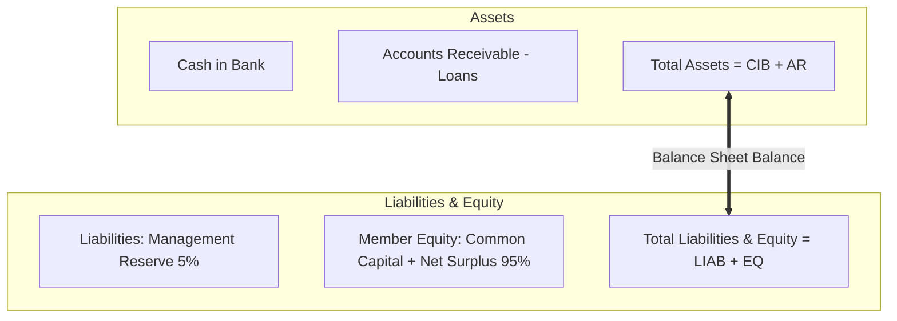

# ⚖️ Wiki: General Ledger & Depository Bank Reconciliation (`/accounting`)

The **Accounting & Bank Reconciliation** module maintains the cooperative's double-entry Statement of Financial Position, monitors physical depository cash vs. virtual book balances, and conducts monthly bank statement reconciliation audits.

---

## 1. Overview & Business Objectives

- **Primary Goal**: Maintain complete mathematical integrity between physical bank deposits, loans receivable, member equity, and distributable surplus with zero-tolerance variance controls.
- **Key Capabilities**: Real-time balance sheet computation, live fund formula verification, monthly bank statement reconciliation, and historical audit trail logging.
- **Role Permissions**: **Administrator Only** (restricted to protect cooperative accounting integrity).

---

## 2. Core Accounting Formulas & The Fund Equation

CoopIS calculates the Statement of Financial Position in real time from atomic database transactions:

### A. Depository Book Cash Balance
$$\text{Book Balance} = \text{Contributions} + \text{Loan Receipts} + \text{Net Bank Interest} - \text{Loan Disbursements}$$
Where:
- $\text{Contributions}$: Sum of all member share capital deposits across all cutoffs.
- $\text{Loan Receipts} = \text{Principal Repayments} + \text{Late Penalties}$ (both paid and accrued across all schedules).
- $\text{Net Bank Interest} = \sum (\text{Gross Bank Interest} - \text{Withholding Tax})$.
- $\text{Loan Disbursements}$: Total net cash capital released to borrowers upon origination.

### B. Reconciliation Variance & Zero-Tolerance Flag
$$\text{Reconciliation Variance} = \text{Book Balance} - \text{Actual Statement Cash in Bank}$$
- **Zero Variance ($\le \text{₱0.01}$)**: The books are in perfect harmony with the depository bank. Displayed with a green **Reconciled** badge.
- **Discrepancy ($> \text{₱0.01}$)**: Unreconciled difference highlighted with a prominent red alert card showing the exact difference.

### C. Total Distributable Interest (Surplus Pool)
$$\text{Distributable Interest} = \text{Loan Upfront Interest} + \text{Total Late Penalties} + \text{Net Bank Interest}$$
This surplus pool feeds the statutory year-end distribution (65% Dividend, 30% Patronage, 5% Management Reserve).

### D. The Balance Sheet Invariant
$$\text{Total Assets} \equiv \text{Total Liabilities} + \text{Total Member Equity}$$

---

## 3. UI Overview & KPI Cards

At the top of `/accounting`, four real-time cards summarize the financial position:

| Card | Value Displayed | Meaning |
|---|---|---|
| **Total Fund Equity** | e.g. `₱2,654,198.12` | Common Share Capital (`₱2,431,054.05`) + Retained Surplus (`₱223,144.07`). |
| **Active Loan Portfolio** | e.g. `₱1,826,465.04` | Outstanding principal receivables across active loans. |
| **Depository Cash in Bank** | e.g. `₱839,477.50` | Physical cash per the latest certified bank statement. |
| **Reconciliation Variance** | e.g. `₱0.00` (or `₱263,380.74`) | Book Balance vs. Depository Cash discrepancy. |

---

## 4. Step-by-Step Operator Procedures

### A. Posting a Monthly Bank Statement Reconciliation
When the official depository bank statement arrives (typically at end-of-month):

1. Navigate to `/accounting` (must be signed in as **Admin**).
2. Click the green **+ Post Bank Reconciliation** button.
3. In the dialog:
   - **Statement Cutoff Date**: Date of the official bank statement (e.g. `2026-01-31`).
   - **Associated Cutoff Period**: Select the matching semi-monthly cutoff period.
     > [!WARNING]
     > A cutoff period can only be reconciled once. If a cutoff has already been reconciled, the system guards against duplicate entries.
   - **Cash in Bank (₱)**:
     - Enter the closing balance printed on the official bank statement.
     - *Helper Shortcut*: Click **"Use Book Balance (₱...)"** to auto-populate the exact ledger book balance if reconciling to match books.
   - **Gross Bank Interest Earned (₱)**: Gross interest credited by the bank.
   - **Withholding Tax (₱)**: Final tax withheld on interest (auto-calculated to standard 20%, but editable to match bank pennies).
   - **Net Bank Interest (₱)**: Auto-calculated as $\text{Gross} - \text{Tax}$.
   - **Audit Notes**: Reference statement numbers or teller initials.
4. Click **Post Reconciliation Entry**.
5. The ledger immediately updates **Cash in Bank**, incorporates the net bank interest into **Total Distributable Interest**, and re-evaluates the variance to ₱0.00.

### B. Inspecting the Bank Audit Log
1. Click the **Bank Statement Audit Log** tab below the metric cards.
2. The table lists every historical statement in reverse chronological order:
   - Statement Date & Cutoff Label.
   - Cash in Bank closing balance.
   - Gross Interest, Withholding Tax, and Net Interest credited.
   - Reconciled Variance at time of posting.
   - Timestamp and administrative notes.

---

## 5. Frequently Asked Questions (FAQ)

**Q: What is the difference between "Current Variance" and "True Book Balance"?**  
*A*: **True Book Balance** is the internal cash balance that should exist in the cooperative bank account based on all logged transactions (contributions + repayments + interest - disbursements). **Current Variance** is the difference between that internal book calculation and the physical balance declared on your official bank statement.

**Q: Why did Reconciliation Variance change to ₱0 after posting?**  
*A*: When you post a bank statement whose Cash in Bank equals the ledger's True Book Balance (or by using the *Use Book Balance* helper), the variance drops to ₱0.00 because physical and internal records are aligned.
